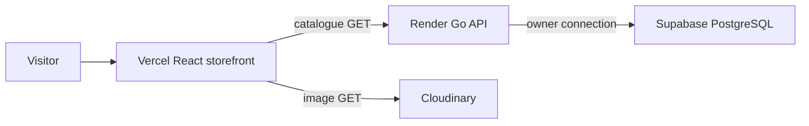
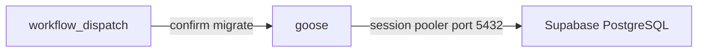

# morrow & muse

A design-led editorial storefront for a fictional boutique. Thoughtfully chosen objects, presented as a portfolio demo. It is not an operating retailer: there is no cart, checkout, account, order, or payment flow.

**Tagline.** THOUGHTFULLY CHOSEN. BEAUTIFULLY LIVED.

**Live demo.** [Storefront](https://morrow-and-muse.vercel.app) · [API](https://morrow-and-muse-api.onrender.com)

**Current status.** The storefront and the read-only catalogue API are deployed. On 19 October 2026 both answered: the shop returned HTTP 200, and the API returned HTTP 200 for `/health`, `/ready`, and the catalogue routes (4 collections, 15 products). The Render free service had been idle, so `/health` took about 12 seconds on the first request. There is no uptime guarantee. A fuller list of what is and is not built is in [Current status](#current-status).

## Contents

1. [Introduction](#introduction)
2. [Product vision and design system](#product-vision-and-design-system)
3. [Features](#features)
4. [Product catalogue](#product-catalogue)
5. [Tech stack](#tech-stack)
6. [Architecture](#architecture)
7. [Project structure](#project-structure)
8. [API reference](#api-reference)
9. [Local development](#local-development)
10. [Environment variables](#environment-variables)
11. [Database schema and migrations](#database-schema-and-migrations)
12. [Security](#security)
13. [Testing and continuous integration](#testing-and-continuous-integration)
14. [Deployment](#deployment)
15. [Current status](#current-status)
16. [Future roadmap](#future-roadmap)
17. [Contributing](#contributing)
18. [Licence](#licence)

## Introduction

morrow & muse is a portfolio MVP: an editorial ecommerce front for objects someone might keep, not a shop that sells them. The copy asks the reader to make room for a slower morning. The software behind that page is a small monorepo: a React storefront, a read-only Go API, and a Postgres catalogue.

The storefront is served from Vercel:

<https://morrow-and-muse.vercel.app>

The API is served from Render:

<https://morrow-and-muse-api.onrender.com>

Useful paths on that host are `/health`, `/ready`, `/api/v1/collections`, `/api/v1/products`, and `/api/v1/products/{slug}`.

The browser never opens a database connection and never receives a database credential. Catalogue reads go to the Go API. Photographs are loaded by the browser from Cloudinary URLs stored in the catalogue.

[docs/deployment.md](docs/deployment.md) is the setup guide. It records these hosts, how to reproduce them, the checks from 19 October 2026, and what is still unverified.

## Product vision and design system

The piece is a fictional boutique for home, stationery, and everyday objects. The audience on the page is someone arranging a quieter routine. The audience for the repository is a reviewer looking at how a design-led interface is built, tested, and hosted on a $0 stack.

The words on the page, taken from the components:

- Tagline, in the header: THOUGHTFULLY CHOSEN. BEAUTIFULLY LIVED.
- Footer line: “Objects for slower mornings, clearer spaces, and everyday rituals.”
- Home heading: “Make room for the good things.”

The home page also uses a longer line, “Thoughtfully chosen objects for slower mornings, clearer spaces, and the small rituals that make a day feel like yours.” The document title in `frontend/index.html` is “morrow & muse | Thoughtfully Chosen. Beautifully Lived.”

Design choices that are actually in [frontend/src/index.css](frontend/src/index.css):

| Role | Implementation |
| --- | --- |
| Headings | DM Serif Display, Latin weight 400, self-hosted with `@fontsource/dm-serif-display` |
| Body | DM Sans, Latin weights 400, 500, and 600, self-hosted with `@fontsource/dm-sans` |
| Background | Ivory, `--color-ivory` `#f7f2ea` |
| Type | `--color-ink` `#292521` |
| Actions | Burgundy, `--color-burgundy` `#722f3e` |
| Accent | Sage, `--color-sage` `#a8b09a` |

Nothing is requested from Google Fonts at runtime. The stylesheet imports the static Latin files above, not a variable font file.

The stylesheet names the type colour `ink`, not charcoal. `#292521` is the charcoal-ink used for text. Two further tokens exist and are used in the interface: sandstone `#e8ded0` and taupe `#77685e`. Sage is a restrained accent, not the primary action colour. Buttons and text links use burgundy.

The layout principles follow from that file and the pages: a serif display face for titles, a plain sans for UI text, an ivory field, one strong action colour, and photography instead of illustration. There is no promotional banner, discount, or cart control, because those features do not exist.

## Features

Each item below is present in the source.

- **Storefront.** Routes in [frontend/src/App.tsx](frontend/src/App.tsx): `/`, `/shop`, `/collections/:slug`, `/products/:slug`, and a catch-all not-found page. The shell is ivory, with a header and footer.
- **Home and featured objects.** The home page leads with the heading above and a featured row. Featured slugs are fixed in [frontend/src/data/catalog.ts](frontend/src/data/catalog.ts): `everyday-ceramic-mug`, `linen-covered-journal`, `canvas-tote-bag`, `sculptural-table-lamp`. Logo, hero, and that slug order stay in the frontend bundle. The API does not serve them.
- **Four collections and fifteen products.** Morning Ritual, Workday Edit, Everyday Carry, and Quiet Space. The product table is below. The same counts came back from the live API.
- **Product detail.** Each product page shows the name, the price, the description, three highlights, the detail image, the collection, and related pieces from the same collection. Those related cards use the card image and the summary. The summary is also the route’s meta description. It is not a paragraph on the product page.
- **Cloudinary images.** Card, detail, collection, logo, and hero URLs are `https://res.cloudinary.com/...` values in the catalogue. The live API returns those URLs. The browser requests the images. The API does not proxy them.
- **Navigation and mobile menu.** Header links for home, shop, and the four collections. Below the `md` breakpoint a button toggles the menu (`aria-expanded`, `aria-controls`). Escape closes it and returns focus to the button when focus is on the button or inside the menu. Escape is ignored when focus is elsewhere. Tests cover that behaviour in [frontend/src/storefront.test.tsx](frontend/src/storefront.test.tsx).
- **Client routing and SPA fallback.** [frontend/vercel.json](frontend/vercel.json) rewrites every path to `/index.html`. Direct loads of `/shop` and `/products/everyday-ceramic-mug` returned HTTP 200 and the same HTML shell. Unknown paths are still HTTP 200 from the host; React Router then renders the not-found page. A real HTTP 404 for unknown URLs is not implemented.
- **Accessibility and the not-found page.** A “Skip to content” link, visible focus rings in burgundy, breadcrumb labels, and a heading sequence the storefront tests check. This is not a formal accessibility audit.
- **Titles and meta descriptions.** [frontend/src/lib/useDocumentMeta.ts](frontend/src/lib/useDocumentMeta.ts) sets `document.title` and the meta description per route. Examples from the tests: “Shop All | morrow & muse”, “Morning Ritual | morrow & muse”, “The Everyday Ceramic Mug | morrow & muse”, “Page Not Found | morrow & muse”.
- **API integration with one bundled fallback.** If `VITE_API_BASE_URL` is unset or blank, the storefront never calls the API. If it is set, the client requests collections and products together, once per session. It replaces the bundled catalogue only when both responses parse. If either fails, both lists stay on the bundle, so a page never mixes the two sources. Product pages look up the slug in that one catalogue. They do not call `/api/v1/products/{slug}`. On 19 October 2026 the deployed bundle contained the Render host, so that build calls the API, and it still has the bundle if that call fails.
- **Tests and CI.** Frontend and backend checks run on push and pull request. See [Testing and continuous integration](#testing-and-continuous-integration).

## Product catalogue

The catalogue is demo data in [frontend/src/data/catalog.ts](frontend/src/data/catalog.ts), seeded into Postgres. It is not inventory. Nothing in the product record is a stock count, and nothing can be purchased.

Prices are integer cents. The storefront formats them in [frontend/src/lib/money.ts](frontend/src/lib/money.ts) with `Intl.NumberFormat('en-US', { style: 'currency', currency: 'USD' })` and two decimal places. $28.00 is 2800 cents.

### Collections

| Collection | Slug | What the description is for |
| --- | --- | --- |
| Morning Ritual | `morning-ritual` | The first coffee, a slower breakfast, and the small routines that start the day |
| Workday Edit | `workday-edit` | Stationery and desk pieces for a working day |
| Everyday Carry | `everyday-carry` | Bags and objects that leave the house |
| Quiet Space | `quiet-space` | Pieces for a calmer room |

### Products

| Product | Collection | Price |
| --- | --- | --- |
| The Everyday Ceramic Mug | Morning Ritual | $28.00 |
| The Stoneware Breakfast Bowl | Morning Ritual | $34.00 |
| The Minimal Ceramic Vase | Morning Ritual | $42.00 |
| The Linen-Covered Journal | Workday Edit | $32.00 |
| The Wooden Desk Organizer | Workday Edit | $48.00 |
| The Black Pen Set | Workday Edit | $24.00 |
| The Neutral Notebook | Workday Edit | $22.00 |
| The Reusable Insulated Bottle | Everyday Carry | $36.00 |
| The Canvas Tote Bag | Everyday Carry | $30.00 |
| The Minimal Travel Pouch | Everyday Carry | $26.00 |
| The Everyday Accessory Tray | Everyday Carry | $24.00 |
| The Sculptural Table Lamp | Quiet Space | $148.00 |
| The Linen Cushion Cover | Quiet Space | $46.00 |
| The Minimal Decorative Tray | Quiet Space | $38.00 |
| The Small Ceramic Planter | Quiet Space | $32.00 |

## Tech stack

Versions are the ones pinned in the repository, not a range.

| Piece | Version | Where |
| --- | --- | --- |
| Node.js | 24.22.0 | [`.nvmrc`](.nvmrc), `engines` in [frontend/package.json](frontend/package.json) |
| React | 19.3.1 | [frontend/package.json](frontend/package.json) |
| React DOM | 19.3.1 | [frontend/package.json](frontend/package.json) |
| TypeScript | 6.0.3 | [frontend/package.json](frontend/package.json) |
| Vite | 8.3.4 | [frontend/package.json](frontend/package.json) |
| React Router | 8.4.0 | [frontend/package.json](frontend/package.json) |
| Tailwind CSS | 4.3.3 | [frontend/package.json](frontend/package.json), via `@tailwindcss/vite` 4.3.3 |
| Vitest | 5.0.5 | [frontend/package.json](frontend/package.json) |
| Testing Library | React 16.3.3, DOM 10.4.2, jest-dom 7.0.1 | [frontend/package.json](frontend/package.json) |
| ESLint | 10.12.0 | [frontend/package.json](frontend/package.json) |
| Prettier | 3.9.10 | [frontend/package.json](frontend/package.json) |
| jsdom | 30.1.3 | [frontend/package.json](frontend/package.json) |
| Go | 1.27.2 | [backend/go.mod](backend/go.mod) |
| chi | v5.5.0 | [backend/go.mod](backend/go.mod) |
| pgx | v5.11.0 | [backend/go.mod](backend/go.mod) |
| goose | v3.29.0 | [backend/go.mod](backend/go.mod) |
| Postgres | 17 | CI service image `postgres:17` in [`.github/workflows/ci.yml`](.github/workflows/ci.yml). The hosted database is Supabase Postgres. |
| Images | Cloudinary | Public `https` URLs in the catalogue. No Cloudinary SDK. |
| Storefront host | Vercel | [frontend/vercel.json](frontend/vercel.json). Hobby, personal, non-commercial. |
| API host | Render | [render.yaml](render.yaml), `plan: free` |
| Migrations in CI and by hand | GitHub Actions | [`.github/workflows/ci.yml`](.github/workflows/ci.yml), [`.github/workflows/db-migrate.yml`](.github/workflows/db-migrate.yml) |

npm is not pinned in `package.json`. Use the npm that ships with Node.js 24.22.0. The lockfile is [frontend/package-lock.json](frontend/package-lock.json).

## Architecture

The visitor’s browser loads the React app from Vercel. That app calls the Go API on Render. The API reads Supabase Postgres. Image bytes come from Cloudinary, requested by the browser, using URLs the catalogue already contains.

The frontend has no database driver and no `DATABASE_URL`. The Go API is the only process that connects, and it connects as the table owner.



Migrations are not part of API startup. Applying them to Supabase is a separate manual workflow. The confirm word is `migrate`. goose then runs against the session pooler.



## Project structure

```text
.
├── .github/workflows/ci.yml
├── .github/workflows/db-migrate.yml
├── .nvmrc
├── .env.example
├── README.md
├── render.yaml
├── docs/deployment.md
├── scripts/export-catalog.ts
├── frontend/
│   ├── index.html
│   ├── package.json
│   ├── vercel.json
│   └── src/
│       ├── App.tsx
│       ├── api/
│       ├── components/
│       ├── data/catalog.ts
│       ├── lib/
│       └── pages/
└── backend/
    ├── go.mod
    ├── cmd/api/
    ├── cmd/migrate/
    ├── db/migrations/
    └── internal/
        ├── catalog/
        ├── config/
        ├── dbpool/
        └── httpapi/
```

`frontend/src/data/catalog.ts` is the source catalogue. `scripts/export-catalog.ts` checks that the SQL seed still matches it. `backend/db/testdata/catalog_export.json` is the fixture the parity test reads.

## API reference

The API is read-only. Implemented methods on catalogue routes are `GET` and `OPTIONS`. There is no cart, auth, order, checkout, or payment route. `POST /api/v1/products` returned HTTP 405.

Success bodies are JSON objects with a `data` field. Errors are:

```json
{"error": {"code": "not_found", "message": "Not found."}}
```

`GET /health` does not touch the database. It answers when the process is up.

```json
{"status": "ok"}
```

`GET /ready` pings Postgres with a one-second timeout. It returns `{"status":"ready"}` when the ping works, and HTTP 503 with `{"error":{"code":"service_unavailable","message":"Not ready."}}` when it does not. [render.yaml](render.yaml) sets the health check path to `/health`, so a paused database does not by itself fail that check. The Render dashboard setting was not read.

`GET /api/v1/collections` returns the four collections in sort order. A truncated live response:

```json
{
  "data": [
    {
      "slug": "morning-ritual",
      "name": "Morning Ritual",
      "description": "Everyday pieces for the first coffee, a slower breakfast and the small routines that help the day begin well.",
      "image": { "src": "https://res.cloudinary.com/…", "alt": "…" },
      "seoTitle": "Morning Ritual | morrow & muse",
      "metaDescription": "…",
      "sortOrder": 1
    }
  ]
}
```

`GET /api/v1/products` returns all fifteen products. Each has exactly three highlights. A truncated live product:

```json
{
  "data": [
    {
      "id": "mm-01",
      "slug": "everyday-ceramic-mug",
      "name": "The Everyday Ceramic Mug",
      "priceCents": 2800,
      "collection": { "slug": "morning-ritual", "name": "Morning Ritual" },
      "summary": "A considered companion for your first coffee, afternoon tea or any small pause worth taking.",
      "highlights": ["…", "…", "…"]
    }
  ]
}
```

`GET /api/v1/products/{slug}` returns one product under `data`. A slug that does not match `^[a-z0-9]+(-[a-z0-9]+)*$` is HTTP 400:

```json
{"error": {"code": "bad_request", "message": "Slug is invalid."}}
```

A well-formed slug that is not in the catalogue is HTTP 404:

```json
{"error": {"code": "not_found", "message": "Product not found."}}
```

A database failure is HTTP 500 with `{"error":{"code":"internal","message":"Something went wrong."}}`. The response does not include SQL or the connection string.

CORS is an exact allowlist from `CORS_ALLOWED_ORIGINS`. There is no `*` and no credential header. Allowed methods are `GET` and `OPTIONS`. Allowed request headers are `Accept` and `Content-Type`. The preflight cache is 600 seconds. An allowed preflight is HTTP 204 and echoes that origin. An unknown origin’s preflight is HTTP 403. A request with no `Origin` is not a preflight; `OPTIONS` without an origin is HTTP 405.

```bash
curl -sS "https://morrow-and-muse-api.onrender.com/health"
curl -sS "https://morrow-and-muse-api.onrender.com/ready"
curl -sS "https://morrow-and-muse-api.onrender.com/api/v1/collections"
curl -sS "https://morrow-and-muse-api.onrender.com/api/v1/products"
curl -sS "https://morrow-and-muse-api.onrender.com/api/v1/products/everyday-ceramic-mug"
curl -sS -D - -o /dev/null -X OPTIONS \
  "https://morrow-and-muse-api.onrender.com/api/v1/collections" \
  -H "Origin: https://morrow-and-muse.vercel.app" \
  -H "Access-Control-Request-Method: GET"
```

On 19 October 2026 those commands returned 200, 200, 200, 200, 200, and 204. `/health` was the slow one, at about 12 seconds, after the free service had slept. `/api/v1/products/Bad_Slug` returned 400. `/api/v1/products/not-a-real-product` returned 404.

## Local development

Prerequisites:

- Node.js 24.22.0, from [`.nvmrc`](.nvmrc). `react-router` 8.4.0 requires Node `>=22.22.0`. `jsdom` 30.1.3 requires Node `^22.22.2`, `^24.15.0`, or `>=26`. `nvm use` at the repository root selects 24.22.0, which satisfies both.
- Go 1.27.2, from [backend/go.mod](backend/go.mod). `GOTOOLCHAIN=auto` downloads that toolchain when the installed `go` is older.
- A disposable Postgres 17 only if you want to run the API or the database tests. Do not point local experiments at the hosted database.

```bash
git clone https://github.com/Desire-in-tech/morrow-and-muse.git
cd morrow-and-muse
nvm install
nvm use
node -v
```

`node -v` should print `v24.22.0`.

Frontend, from `frontend/`:

```bash
cd frontend
npm ci
npm run dev
```

Vite’s default URL is `http://localhost:5173/`. Leave `VITE_API_BASE_URL` unset or blank to keep the bundled catalogue and make no catalogue request.

Frontend checks, still in `frontend/`:

```bash
npm run typecheck
npm run lint
npm run format:check
npm run test
npm run build
```

`npm run build` is `tsc -b && vite build`. From the repository root, the catalogue fixture check is:

```bash
node --experimental-strip-types scripts/export-catalog.ts --check
```

API, from `backend/`:

```bash
cd backend
export DATABASE_URL="<your-private-database-connection-string>"
export CORS_ALLOWED_ORIGINS="http://localhost:5173"
go run ./cmd/api
```

`PORT` defaults to `8080`. Then:

```bash
curl -sS "http://127.0.0.1:8080/health"
```

To load the API catalogue in the dev server, set `VITE_API_BASE_URL` to the API origin with no trailing slash, for example `http://127.0.0.1:8080`, and restart Vite. The value is read at build time in production, so a local dev server is the place to change it without a redeploy.

Migrations run from `backend/`. That directory holds `go.mod` and `cmd/migrate`. CI and [`.github/workflows/db-migrate.yml`](.github/workflows/db-migrate.yml) set the same working directory. The workflow runs `up` only. The value must not be a hosted URL unless you mean to change that database. [docs/deployment.md](docs/deployment.md) shows the hidden prompt so the string is not stored in shell history and is not a command argument.

Apply:

```bash
cd backend
printf 'DATABASE_URL: '
read -rs DATABASE_URL
printf '\n'
export DATABASE_URL
go run ./cmd/migrate up
unset DATABASE_URL
```

`up` applies versions 1, 2, and 3. A successful run prints nothing.

Rollback is a different command. It is destructive. Run it only against a disposable local database. Never run `down-to` against the hosted database to try an idea.

`go run ./cmd/migrate down-to 0`, still from `backend/`, rolls this module back to goose version 0. After a full `up`, goose runs the Down section of `00003`, then `00002`, then `00001`. Version 2 deletes the rows in `featured_products`, `product_highlights`, `products`, `collections`, and `catalog_assets`. Version 1 then drops those tables, their triggers, and the three trigger functions. `goose_db_version` remains. The catalogue schema and data from this module are gone.

`go run ./cmd/migrate down-to 2` rolls back only version 3, [backend/db/migrations/00003_lock_down_public.sql](backend/db/migrations/00003_lock_down_public.sql). The tables and the seed stay. Its Down section:

- disables row level security on `collections`, `products`, `product_highlights`, `featured_products`, `catalog_assets`, and `goose_db_version`
- where the roles exist, grants `anon` and `authenticated` `ALL` on those tables and on sequences in `public`, grants them `EXECUTE` on the three trigger functions, and restores the schema-public default privileges version 3 revoked
- grants `EXECUTE` on those three functions to `PUBLIC`
- replaces the three functions with the version-1 bodies and resets `search_path`

It does not grant table or sequence privileges back to `PUBLIC`. The version-1 bodies use unqualified table names and unqualified `clock_timestamp()`. The version-3 bodies schema-qualify the tables, call `pg_catalog.clock_timestamp()` in `set_updated_at`, and set `search_path` to empty.

Backend checks, from `backend/`:

```bash
gofmt -l .
go vet ./...
go test ./...
go build -o bin/api ./cmd/api
```

Database tests skip when `TEST_DATABASE_URL` is unset, except in CI, where a missing URL fails the run. CI sets it to the disposable Postgres service.

The processes do not load `.env` files. [`.env.example`](.env.example) is a placeholder sketch only. Do not put a live password in it, and do not commit a filled `.env`.

## Environment variables

| Variable | Where it is read | Notes |
| --- | --- | --- |
| `VITE_API_BASE_URL` | Vite, at build time, in the browser bundle | Public. No trailing slash. Unset or blank means the bundled catalogue and no fetch. Changing it on Vercel requires a new deployment. |
| `DATABASE_URL` | Go API and `cmd/migrate`, from the environment | Server-only secret. `DATABASE_URL=<your-private-database-connection-string>`. Never commit it. |
| `CORS_ALLOWED_ORIGINS` | Go API | Comma-separated origins. Exact match, no wildcard, no trailing slash, no path. A 19 October 2026 preflight showed that the allowlist includes `https://morrow-and-muse.vercel.app`. The rest of the value was not read. |
| `PORT` | Go API | Defaults to `8080`. Render injects it. Do not set it on Render. |
| `TEST_DATABASE_URL` | Go tests | Disposable database only. Not used by the API. |

## Database schema and migrations

Postgres holds the catalogue. The API only selects. goose versions:

| Version | File | What it does |
| --- | --- | --- |
| 1 | [backend/db/migrations/00001_schema.sql](backend/db/migrations/00001_schema.sql) | Tables, checks, and triggers |
| 2 | [backend/db/migrations/00002_seed.sql](backend/db/migrations/00002_seed.sql) | Seed generated from `catalog.ts` |
| 3 | [backend/db/migrations/00003_lock_down_public.sql](backend/db/migrations/00003_lock_down_public.sql) | Row level security and privilege revocation |

Tables:

- `collections` — one row per collection. `slug` is unique. `products.collection_id` references `collections.id`.
- `products` — one row per product. `id` is a text key such as `mm-01`. `slug` is unique. Prices are `price_cents`.
- `product_highlights` — `(product_id, position)` with `position` from 1 to 3. Deleting a product cascades.
- `featured_products` — the ordered featured subset. Not every product is featured.
- `catalog_assets` — logo and hero. The HTTP API does not return this table. The storefront keeps those assets in the bundle.
- `goose_db_version` — goose’s history. It records versions 0, 1, 2, and 3 after a full `up`.

Deferred constraint triggers require exactly three highlights. `products_require_three_highlights` runs after insert or update on `products`. `product_highlights_require_three` runs after insert, update, or delete on `product_highlights`. Both are deferrable, so a product and its three highlights can be written in one transaction. A bad write fails at commit with `product … must have exactly 3 highlights`. `set_updated_at` sets `updated_at` from `clock_timestamp()` on `collections` and `products`.

Apply from `backend/`, the directory that contains `go.mod`:

```bash
go run ./cmd/migrate up
```

Hosted applies use the manual workflow [`.github/workflows/db-migrate.yml`](.github/workflows/db-migrate.yml). It does not run on push or pull request. In the Actions tab: Migrate database, branch `main`, confirm input `migrate`. The job refuses any other confirm value, checks that the `DATABASE_URL` secret is a `postgres` or `postgresql` URL with a host, a user, a password, and `sslmode` of `require`, `verify-ca`, or `verify-full`, refuses port 6543, warns if the port is not 5432, and runs `go run ./cmd/migrate up` with working directory `backend`. It does not print the URL. It does not run `down-to`. Do not type a connection string into the confirm box.

`down-to 0` and `down-to 2` are described in [Local development](#local-development). They are for a disposable local database only.

## Security

This section records how the project is put together, and what project-run database checks reported. It is not a professional security audit. The demo is not claimed to be fully production-hardened.

The storefront reads through the Go API. The API connects as the table owner (`postgres` on Supabase). That role bypasses row level security when it is not forced, and on Supabase it also has `BYPASSRLS`. The migration does not use `FORCE ROW LEVEL SECURITY`, so the owner can keep reading the catalogue and goose can keep writing `goose_db_version`.

Migration `00003_lock_down_public.sql` enables row level security on `collections`, `products`, `product_highlights`, `featured_products`, `catalog_assets`, and `goose_db_version`. It creates no policies. It revokes table, sequence, and function privileges from `PUBLIC`, `anon`, and `authenticated` where those roles exist. `service_role` is unchanged. It is a server-only Supabase role and already bypasses row level security.

The three trigger functions, `set_updated_at`, `products_have_three_highlights`, and `product_highlights_stay_three`, are replaced with `search_path` set to empty. Table names in the bodies are schema-qualified. `EXECUTE` on those functions is revoked from `PUBLIC`, `anon`, and `authenticated`.

A project-run read-only check through the Supabase management connection on 19 October 2026 reported the following. It was not an independent audit. This review did not re-query the database. The HTTP checks that day were separate and did not inspect privileges.

- goose versions 0, 1, 2, and 3 were applied. Version 3 was recorded at 18:04:47 EAT (15:04:47 UTC).
- Row counts were collections 4, products 15, product_highlights 45, featured_products 4, and catalog_assets 2.
- All 36 Cloudinary URLs matched [frontend/src/data/catalog.ts](frontend/src/data/catalog.ts).
- Row level security was enabled and not forced on the six tables, with no policies.
- Privileges for `PUBLIC`, `anon`, and `authenticated` were revoked on the tables, on sequences, and on the three trigger functions.
- Those three functions had `search_path` set to empty.
- The Supabase advisors then showed `rls_enabled_no_policy` (INFO, expected with no policies) and `unused_index`.

GitHub Actions also records a successful `workflow_dispatch` of Migrate database on commit `135578461356cbf1d4940dd8e36a1300ed6cf849`, finishing at 15:04:51 UTC that day. That run executes `up`. It does not print the database, so it is not itself the SQL result above.

The public API cannot show the lock-down, because the owner connection bypasses row level security. `/ready` returning 200 only shows that Postgres accepted the owner ping.

`TestSecurityHardening` in [backend/db/security_test.go](backend/db/security_test.go) includes the subtest `public_schema_guard`. After the migrations it fails CI if a non-extension function in `public` is still executable by `PUBLIC`, `anon`, or `authenticated`, if a table or sequence grant to those roles remains, or if a table in `public` does not have row level security. The guard sees objects created by goose. It does not see objects created later outside a migration.

Known limitations, from the migration and the checks:

- Objects created by `supabase_admin`, or created by hand in the Supabase SQL editor, are outside that guard. A function created that way is still executable by `PUBLIC` until someone revokes it. Review those separately.
- `anon` still has `USAGE` on schema `public`. The migration does not revoke it. Table privileges are what block reads.
- There is no authentication or authorisation layer. There are no user accounts, so there is nothing to authorise. The API is a trusted server process using the owner connection. Anyone who can call the public host can read the catalogue. They cannot write it through the routes that exist.
- Default privileges for `supabase_admin` cannot be changed by the migration role. New tables created by `postgres` are not granted to `anon` or `authenticated`, but a later migration must still enable row level security itself, and must revoke `EXECUTE` on any new function. `service_role` keeps its default grants.
- The database credential lives only in the server environment and in the GitHub Actions secret used by the migrate workflow. It is not in the frontend bundle.

## Testing and continuous integration

Workflows:

| Workflow | File | When it runs | Jobs |
| --- | --- | --- | --- |
| CI | [`.github/workflows/ci.yml`](.github/workflows/ci.yml) | Push to any branch, and pull request | `frontend`, `backend` |
| Migrate database | [`.github/workflows/db-migrate.yml`](.github/workflows/db-migrate.yml) | `workflow_dispatch` only | `migrate` |

The frontend job runs `npm ci`, `npm run typecheck`, `npm run lint`, `npm run format:check`, `npm run test`, `node --experimental-strip-types scripts/export-catalog.ts --check`, and `npm run build`.

The backend job starts Postgres 17 with a disposable user and database, then runs `gofmt`, `go vet`, `go run ./cmd/migrate up`, `down-to 0`, `up` again, and `go test ./...`.

Frontend tests:

- [frontend/src/App.test.tsx](frontend/src/App.test.tsx)
- [frontend/src/storefront.test.tsx](frontend/src/storefront.test.tsx)
- [frontend/src/catalog.test.ts](frontend/src/catalog.test.ts)
- [frontend/src/api/catalogClient.test.ts](frontend/src/api/catalogClient.test.ts)
- [frontend/src/api/catalogSession.test.tsx](frontend/src/api/catalogSession.test.tsx)

Backend tests:

- [backend/db/parity_test.go](backend/db/parity_test.go) — seed matches the catalogue export
- [backend/db/security_test.go](backend/db/security_test.go) — lock-down, `public_schema_guard`, anon denial, triggers, down/up
- [backend/internal/httpapi/router_test.go](backend/internal/httpapi/router_test.go)
- [backend/internal/httpapi/integration_test.go](backend/internal/httpapi/integration_test.go)
- [backend/internal/config/config_test.go](backend/internal/config/config_test.go)
- [backend/internal/dbpool/pool_test.go](backend/internal/dbpool/pool_test.go)

## Deployment

The full guide is [docs/deployment.md](docs/deployment.md). This is the short version of what that guide and the live hosts use. The budget is $0. Do not add a payment method or a paid add-on, including the Supabase IPv4 add-on.

**Vercel.** Root directory `frontend`, framework Vite, install `npm ci`, build `npm run build`, output `dist`, Node.js 24.x. The SPA rewrite is [frontend/vercel.json](frontend/vercel.json). Set `VITE_API_BASE_URL` to `https://morrow-and-muse-api.onrender.com` with no trailing slash before the production build. Changing it means deploying again. The production origin is `https://morrow-and-muse.vercel.app`.

**Render.** [render.yaml](render.yaml) describes a free Go web service named `morrow-and-muse-api`, root directory `backend`, build `go build -o bin/api ./cmd/api`, start `./bin/api`, health check `/health`. `DATABASE_URL` and `CORS_ALLOWED_ORIGINS` are set in the dashboard, not in the file. Saving an environment change restarts the service. `CORS_ALLOWED_ORIGINS` must include the exact Vercel origin, `https://morrow-and-muse.vercel.app`, with no trailing slash. A preview URL is a different origin and is not allowed until it is added.

**Supabase.** Use the session pooler, port 5432, with `sslmode=require`. Do not point goose at the transaction pooler on port 6543. The API can use the same session URI. Direct connections on the free plan are IPv6. The session pooler is the path that stays on the free plan without the IPv4 add-on.

**Migrations.** After a migration is on `main`, run the Migrate database workflow with confirm input `migrate`. The workflow runs `up` only. Do not paste a connection string into an issue, a shell history, or the confirm box. If a password was exposed, reset it before storing the new URI. [docs/deployment.md](docs/deployment.md) has that procedure. This repository does not record whether a rotation has been done.

**Free tier.** A Render free web service spins down after a period without traffic. The next request cold-starts it. That is what the 12 second `/health` showed. A Supabase free project can be paused after a stretch of inactivity, which makes `/ready` fail and makes the storefront fall back to the bundled catalogue. There is no uptime guarantee. Numeric limits and the vendor pages they come from are in [docs/deployment.md](docs/deployment.md). They are not restated here.

The curls in [API reference](#api-reference), and the storefront loads, are the checks from 19 October 2026. [docs/deployment.md](docs/deployment.md) records the same results.

## Current status

**Implemented and deployed**

- Editorial storefront on Vercel, including home, shop, four collections, fifteen product pages, mobile navigation, client-side not-found page, and per-route titles.
- Read-only Go API on Render, with `/health`, `/ready`, and the catalogue routes. Live responses matched the shapes above.
- Postgres catalogue on Supabase, reached by the API. The live list endpoints returned 4 collections and 15 products, each product with 3 highlights.
- Catalogue fallback in the client, CI, and the manual migration workflow.
- Public-schema lock-down in goose version 3, plus the CI guard. A project-run read-only check on 19 October 2026 reported versions 0–3 applied on the hosted database. This review did not re-query it, and the public API cannot prove the lock-down.

**Not implemented**

- Cart, checkout, payments, tax, shipping, inventory, and orders.
- Accounts, sessions, and authorisation.
- Search, filtering, sorting controls, pagination, and wishlists.
- An admin UI, image upload, and catalogue editing.
- HTTP 404 from the host for unknown storefront URLs.
- A formal accessibility, performance, or security audit.
- Uptime monitoring and an error screen when the API is down. The storefront keeps the bundled catalogue instead.

## Future roadmap

The phases below are **PROPOSED**. They are not scheduled, and they are not started.

1. **Quality and observability.** Clearer error states, structured logs, smoke checks against the deployed URLs, stronger Postgres integration tests, accessibility and responsive reviews, SEO and performance passes, and monitoring that stays on the free tier.
2. **Product discovery.** Search, filtering, sorting, pagination, a wishlist, and richer product attributes or variants.
3. **Customer experience.** A cart, a cart that survives a reload, accounts, preferences, and creating or reading an order. Still no payment in this phase.
4. **Commerce, only if this becomes a real store.** Inventory, fulfilment, a payment provider, signed webhooks, refunds, shipping, tax, regional pricing, and the policies that go with taking money. The current Hobby deployment is personal and non-commercial. This phase would be a different project.
5. **Administration and maintainability.** A protected admin, catalogue editing, image upload, backup and recovery, an explicit API version policy, an OpenAPI document, rate limiting, and a written authorisation and threat model.

**Separate database login, proposed and not built.** The API connects as the table owner (`postgres` on Supabase), which bypasses row level security. A later migration could add a login role with `SELECT` only on `collections`, `products`, and `product_highlights`, and a `SELECT` policy on each of those tables, and leave goose on the owner role. Render would then use a different `DATABASE_URL` from the migrate workflow. The shared-pooler username would be `[ROLE].[PROJECT-REF]`. With row level security on and no policy, a role that is not the owner and does not bypass row level security would see no rows. `/ready` only pings; it does not need table privileges. The queries are in [backend/internal/catalog/postgres.go](backend/internal/catalog/postgres.go). [docs/deployment.md](docs/deployment.md) records the same constraint. Do not point the migrate secret at the reader role.

## Contributing

Use a feature branch and open a pull request. Before asking for review, run the frontend and backend checks in [Local development](#local-development). CI runs those frontend commands and the backend `gofmt`, `go vet`, and `go test` steps. It does not run `go build` as its own step.

Do not commit secrets, `.env` files, connection strings, or database passwords. [`.env.example`](.env.example) stays a placeholder.

Database changes belong in a new goose migration. Do not edit `00001`, `00002`, or `00003` once they have been applied. A new table in `public` has to enable row level security. A new function in `public` has to revoke `EXECUTE` from `PUBLIC`, `anon`, and `authenticated`. `public_schema_guard` is the CI check for that. Applying a migration to Supabase is deliberate: merge first, then run the Migrate database workflow. Do not run `down-to` against the hosted database to try an idea.

The catalogue source is [frontend/src/data/catalog.ts](frontend/src/data/catalog.ts). If you change it, regenerate the seed with the export script and keep `scripts/export-catalog.ts --check` green.

## Licence

This repository has no `LICENSE` file. No licence is specified. Do not assume you may copy, modify, or reuse the code, the copy, or the photographs without one.
